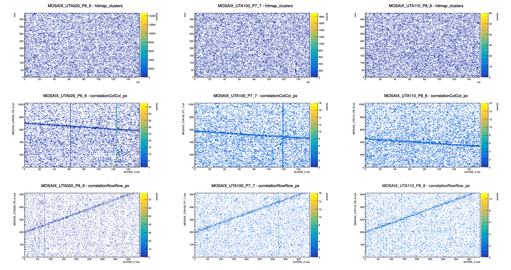
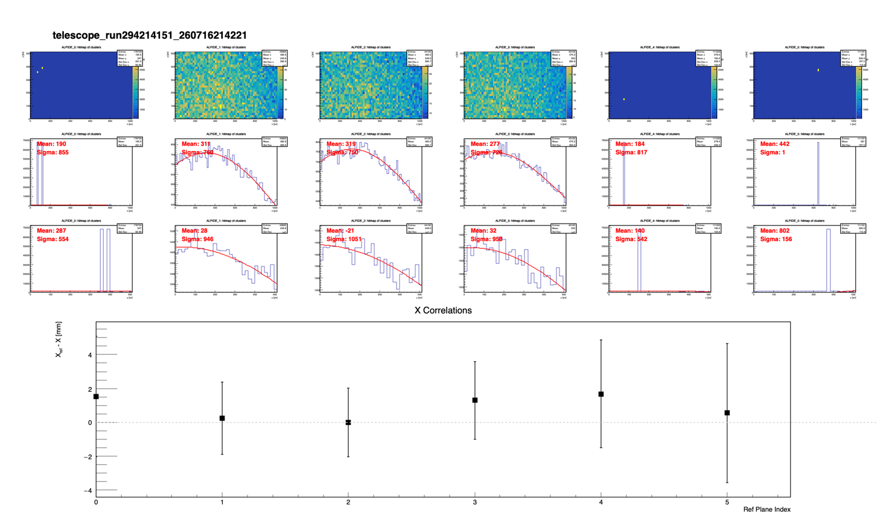
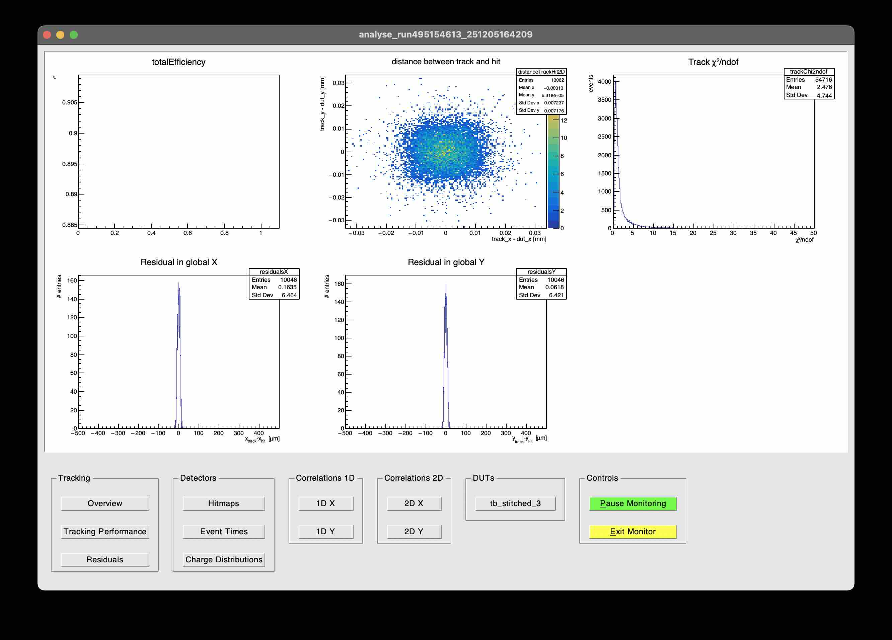

# Online QA(quality assurance) code for MOSAIX data 
- Made for testbeam at KEK, November 2026

## Code usage
- **make sure you change the corry excutable to your path e.g. `CORRY=/YOUR/CORRY/PATH/bin/corry` at `setup.sh`**
- Output root file and the image will be saved inside `./output`

### `RUN_QA.sh RAW_FILE_PATH`
:checks correlation between ALPIDE & DUT

- This will run `QA.conf` for 30 K events, and then plot with `plot_mosaix_correlations.py`

### `FIND_TELESCOPE_POS.sh RAW_FILE_PATH`
:checks current position of telescope by clustermap, correlation between ALPIDEs

- This will run prealignment for all of the events, and then plot with `plot_alpide.py`

### `QUICK_ANALYSIS.sh RAW_FILE_PATH`
:checks rough efficiency & residuals etc..

- This will run prealignment & alignment for 30K events, and then analyse data will full events
- Please note that this is **LOWER THAN REAL EFFICIENCY** as it does not account for the inter-region gap.
- Calculating efficiency, residual, etc. for each region should be done in the offline analysis.