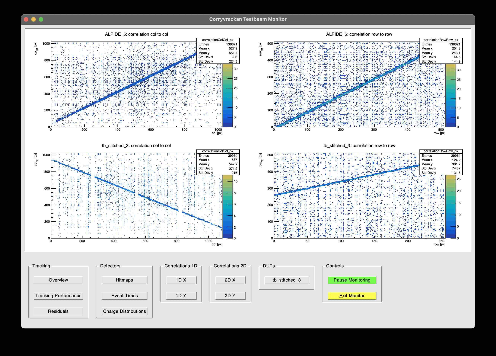
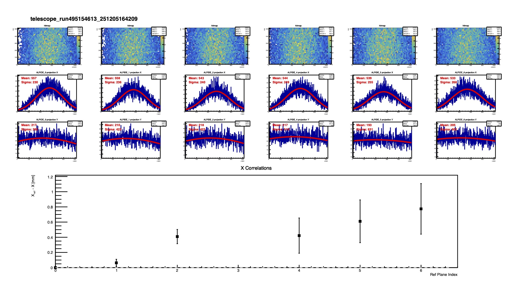

# QA code for online data quality assurance

## Requirement
- corryvreckan [gitlab](https://gitlab.cern.ch/koalice-kek-testbeam/corryvreckan)
- EUDAQ with TUM modification [gitlab](https://gitlab.cern.ch/koalice-kek-testbeam/eudaq2)
- The installation guide is [here, but you should change the GitLab link to uppers.](https://docs.google.com/document/d/1OW0J2s7UMyx0hnq9vXF-ypAbczc4DmXrRRiOdjomFmM/edit?tab=t.0)
- The examples shown below are run for `202512_KEK_DATA/6ALPIDE1babyMOSS/run495154613_251205164209.raw` [You can download here](https://cernbox.cern.ch/remote.php/dav/public-files/U2L4gZHdfYRe7KB/6ALPIDE1babyMOSS/run495154613_251205164209.raw)

## Code usage
- **make sure you change the corry excutable to your path e.g. `CORRY=/YOUR/CORRY/PATH/bin/corry` at `setup.sh`**
- Output root file and the image will be saved inside `./output`

### `RUN_QA.sh RAW_FILE_PATH`
:checks correlation between ALPIDE & DUT

### `FIND_TELESCOPE_POS.sh RAW_FILE_PATH`
:checks current position of telescope by clustermap, correlation between ALPIDEs

- This will run prealignment for 30K events, and then plot with `DrawHitmapCorrelation.py`

### `QUICK_ANALYSIS.sh RAW_FILE_PATH`
:checks rough efficiency & residuals etc..

- This will run prealignment & alignment for 30K events, and then analyse data will full events
- Please note that this is **LOWER THAN REAL EFFICIENCY** as it does not account for the inter-region gap.
- Calculating efficiency, residual, etc. for each region should be done in the offline analysis.